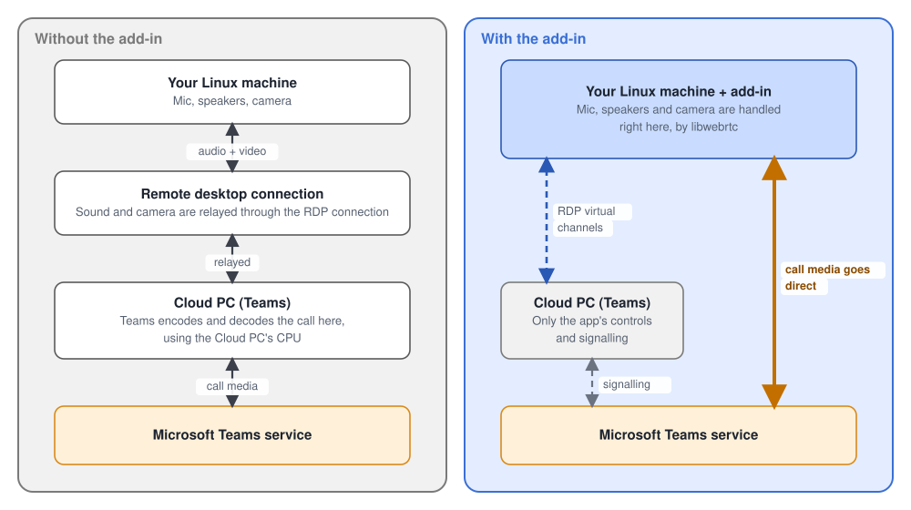

# freerdp-teams-redir

A [FreeRDP](https://www.freerdp.com/) 3 add-in that lets **Microsoft Teams audio calls** use the
local machine's microphone and speakers when Teams runs inside an **Azure Virtual Desktop** session
on **Linux**. It plays the part that Microsoft's Windows and macOS clients play in "Teams media
optimization", so audio is handled locally instead of being relayed through the remote desktop.

> **Status: early development build, not a release.** Audio calls work, including in a scheduled
> meeting, where the other people's video and a shared screen also show up (see
> [Status](#status)). Sending your own video in a call is not confirmed yet, and sending your screen
> does not exist. This is an independent project and is not affiliated with or endorsed by
> Microsoft.

The add-in is a FreeRDP dynamic virtual channel plugin. It is loaded with `/dvc:teams-redir`, and
speaks the redirection protocol that the Teams session host exposes on the virtual channels
`com.microsoft.rdc.dvc.webrtc.1` and `com.microsoft.rdc.dvc.cpc.1`. Calls run on libwebrtc,
linked in statically.

## What it does

Without media optimization, a call in Teams inside the session is handled on the Cloud PC, and your
sound and camera are relayed through the remote desktop connection. With the add-in, the call is
handled on your machine and only the controls stay in the session.



Teams in the session sends its WebRTC calls to Microsoft's redirector service, which forwards them
over RDP virtual channels to the add-in inside your FreeRDP client. The add-in runs them on
libwebrtc and answers, and the audio and video go straight to the Teams service.


## Status

Tested against a real Azure Virtual Desktop session host: Teams' "Make a test call" service and
calls with real people, one-to-one and in a scheduled meeting.

| Works | Not done yet, or not confirmed |
|---|---|
| Teams shows "AVD media optimized" | **Sending your own video in a call** is not confirmed. The first attempt crashed the client (the Intel hardware encoder, now off by default); the fix has not been tried in a call |
| Microphone, speaker and camera lists, with the default devices | Sending your own screen (screen sharing from this machine does not exist) |
| Audio calls: the microphone is sent and remote audio plays | Choosing a different microphone or speaker in the middle of a call is untested |
| Incoming calls: ringing tone and a desktop notification (a desktop in do-not-disturb hides it) | Downloading the tones from Microsoft; an installer or distro package |
| Ringing and call-ended tones (from local files, or a plain built-in tone) | HID devices (headset buttons) |
| Joining a scheduled meeting: audio works, and other people's video and a shared screen show up, each in its own window | Video placed inside the Teams window instead of its own windows |
| Teams' device settings preview of the webcam (V4L2, MJPEG or YUYV), in its own window | Several cameras at once, and unplugging or plugging a camera during a call |
| The data channel, stats, ICE and DTLS that Teams expects | Hardware video encoding (opt-in, and it crashed once; see the [FAQ](#faq)) |
| H.264 / VP8 / VP9 / AV1 video, checked against the real engine on a real camera | |

## Requirements

- Linux on x86-64. LiveKit also publishes an arm64 libwebrtc, but it has not been tried.
- FreeRDP 3.x with its development headers (the SDL client `sdl-freerdp3` is what has been used).
- An Azure Virtual Desktop session host with the Teams media optimization components installed
  (the Remote Desktop WebRTC Redirector Service), and Teams running in the session.
- PipeWire or PulseAudio. The add-in uses `pactl` to list devices and `paplay` for the tones.
- To build: `rust`, `cargo`, `cbindgen`, `cmake`, `clang`, `pkg-config`. On Arch:
  `pacman -S freerdp rust cbindgen cmake clang`.
- Optional: `notify-send` (libnotify) or `gdbus` for call notifications.
- For video: a V4L2 webcam (any UVC camera), and SDL3 with its development files to build the
  video window helper. Without SDL3 the build still works and there are no video windows.

## Build

```sh
cmake -S . -B build -DCMAKE_BUILD_TYPE=Release
cmake --build build
ctest --test-dir build        # loads the module through FreeRDP's plugin interface
cargo test --workspace        # unit tests, plus replays of recorded Teams calls
```

The first build downloads LiveKit's prebuilt libwebrtc (about 150 MB, 700 MB unpacked) into the
build directory. To share one copy between build directories, unpack the release
`webrtc-linux-x64-release.zip` from <https://github.com/livekit/rust-sdks/releases> (tag
`webrtc-a545de4`) once, and point `LK_CUSTOM_WEBRTC` at the directory that holds `include/` and
`lib/` before running `cmake` or `cargo`.

`cargo build -p teams-redir-ffi --no-default-features` builds with a fake media engine and downloads
nothing. It is for working on the protocol code only.

To build against a FreeRDP in a non-standard prefix:
`PKG_CONFIG_PATH=<prefix>/lib/pkgconfig cmake -S . -B build ...`. Rebuild the add-in whenever that
FreeRDP is rebuilt.

## Install and run

FreeRDP resolves `/dvc:teams-redir` to `libteams-redir-client.so` in `<prefix>/lib/freerdp3`, where
the prefix is fixed when FreeRDP is compiled. Install the module there:

```sh
sudo install -D build/libteams-redir-client.so /usr/lib/freerdp3/libteams-redir-client.so
# or, for a FreeRDP in your home directory:
install -D build/libteams-redir-client.so ~/opt/freerdp/lib/freerdp3/libteams-redir-client.so
```

Then add the channel to your usual command line:

```sh
sdl-freerdp3 /v:<host> ... /dvc:teams-redir
```

Restart Teams in the session once after connecting. The Teams window shows "AVD media optimized"
when the add-in is in use. Without a system-wide install, `tools/ns-run.sh <module> <command>` runs
a command with the module overlaid in a private user namespace and changes nothing on disk.

`TEAMS_REDIR_DISABLE=1` in the environment of the FreeRDP process turns the add-in off.

## Tones and call notifications

Teams asks the client to play a ringing tone and a call-ended tone from a URL on Microsoft's CDN.
This client **does not fetch that URL** (the session host is not trusted to name what the client
downloads). It plays a local file instead: the file name in Teams' URL picks a file from
`~/.local/state/teams-redir/notify-audio/`. The two names Teams uses are `Teams_Call_Ringing.mp3`
and `Teams_Call_Ended.mp3`, and an incoming call rings with `ring.mp3`. Any mp3 works.
`TEAMS_REDIR_NOTIFY_FILE=/path/to/sound.mp3` plays one file for every sound, and
`TEAMS_REDIR_NOTIFY_DIR` moves the directory. Without a file, these three sounds get a plain tone
made by the add-in (`TEAMS_REDIR_BUILTIN_TONES=off` turns that off); any other sound is skipped.

A ringing call also shows a **desktop notification** ("Incoming Teams call"), through the freedesktop
notification service (mako, dunst, GNOME, KDE and others) via `notify-send`, or `gdbus` without it.
Teams does not tell the client who is calling, so the text is generic. The add-in is never told "a
call is incoming"; it sees Teams ask for a looping sound, which is how a ring arrives. The caller's
own ringback does not trigger it, and `TEAMS_REDIR_CALL_ALERT_SOUNDS=name.mp3,...` limits it to
named sounds.

```sh
tools/call-notifications.sh on|off|toggle|status   # takes effect at the next ring, no restart
tools/call-notifications.sh test                   # shows a sample notification
```

The notification is an ordinary one, so a desktop in **do-not-disturb** mode silences it (the add-in
does not try to get past that). On Omarchy, `omarchy-toggle-notification-silencing` turns the mode off,
and a silenced notification is still kept in the notification history.

The switch is the file `~/.local/state/teams-redir/call-notifications`. Without it,
`TEAMS_REDIR_CALL_NOTIFICATIONS=off` sets the default, and the notification is on otherwise.

## Video

Cameras appear in Teams' device list, and when Teams asks for a camera the add-in captures from it
(V4L2, MJPEG or YUYV), and encodes with libwebrtc: H.264 (OpenH264), VP8, VP9 or AV1, whichever the
call negotiates. **The camera is on only while Teams has the video on**: muting the camera in Teams
closes the device, so its light goes off.

A FreeRDP add-in has no window to draw in, so remote pictures and your own self view are shown by
a small helper program, `teams-redir-video` (`crates/video-window`, SDL3, Wayland and X11), which the
add-in starts when the first picture arrives. It opens **one ordinary window per video element**
that Teams creates (see below for when). It honours mirroring, object-fit and visibility
as Teams sets them. The windows are not drawn over the Teams window: Teams sends where it wants the
picture placed, but this client does not composite into the RDP window (that needs support in the
FreeRDP client itself). The windows use the application id `teams-redir-video`, so a window rule in
your compositor can place or float them. Teams opens and closes video elements often, and each window
that comes or goes makes a tiling desktop rearrange, so a window opens only once its picture has kept
coming for 0.7 s, and a window whose element closed stays for 5 s so the next element takes it over
instead of a new one opening (`TEAMS_REDIR_VIDEO_OPEN_DELAY_MS` and `TEAMS_REDIR_VIDEO_KEEP_MS`
change these; the helper reads them from the environment of the FreeRDP client). If the helper cannot
start, the call and its audio carry on without pictures, and a warning is logged.

`teams-redir-video` is installed next to `libteams-redir-client.so`; `TEAMS_REDIR_VIDEO_HELPER`
names another path. `TEAMS_REDIR_VIDEO=off` stops offering video altogether.

## Configuration

Environment variables of the FreeRDP process:

| Variable | Meaning |
|---|---|
| `TEAMS_REDIR_DISABLE` | `1`: do not listen on either channel |
| `TEAMS_REDIR_STATE_DIR` | Where state is kept. Default `$XDG_STATE_HOME/teams-redir`, else `~/.local/state/teams-redir` |
| `TEAMS_REDIR_TRANSCRIPTS` | A directory for message transcripts, or `off`. Default `<state dir>/transcripts` |
| `TEAMS_REDIR_NOTIFY_DIR`, `TEAMS_REDIR_NOTIFY_FILE` | Local tones, see above |
| `TEAMS_REDIR_CALL_NOTIFICATIONS`, `TEAMS_REDIR_CALL_ALERT_SOUNDS` | Call notifications, see above |
| `TEAMS_REDIR_BUILTIN_TONES` | `off`: no made-up tone for a sound that has no file |
| `TEAMS_REDIR_VIDEO` | `off`: do not offer video (no cameras, no video codecs) |
| `TEAMS_REDIR_VIDEO_HELPER` | Path of `teams-redir-video`; default: next to the add-in, then `PATH` |
| `TEAMS_REDIR_VIDEO_OPEN_DELAY_MS` | How long a picture must keep coming before its window opens (default 700) |
| `TEAMS_REDIR_VIDEO_KEEP_MS` | How long a window stays after its element closed, for the next one to take over (default 5000; 0 closes at once) |
| `TEAMS_REDIR_CPC` | How the `cpc.1` channel answers: `honest` (default), `macstore`, `off` |
| `TEAMS_REDIR_CLIENT_PLATFORM`, `_APP_NAME`, `_APP_VERSION`, `_FLAVOR`, `_WEBRTC`, `_WEBRTC_REDIRECTOR` | The client identity strings sent to the host |

Logs go to FreeRDP's wLog under `com.freerdp.channels.teams-redir`; raise the level with
`WLOG_LEVEL=DEBUG`.

### Features that are hot-swappable

`tools/experiment.sh v1-clip-region` and `v2-mirror-self` change the features the add-in reports to
Teams for video (see `experiments/README.md`), without a rebuild; restart Teams in the session to
apply.

### Transcripts contain secrets

With transcripts on (the default), every message in and out is written to
`<state dir>/transcripts/`. A call's transcript includes the **TURN relay credentials**, call and
participant ids, and the ICE passwords and DTLS fingerprints from the SDP. Treat the files as private
and redact them before sharing: `golden/` holds examples of how that was done. Set
`TEAMS_REDIR_TRANSCRIPTS=off` to stop writing them.

## How it works

The picture above shows where the parts run. Inside the add-in, one library holds a small C shim for
FreeRDP and a Rust core:


Teams in the session does not use a browser WebRTC stack. Its JavaScript calls (`createOffer`,
`addTransceiver`, `getStats` and so on) are forwarded as JSON messages over the `webrtc.1` channel,
and the client is expected to run them against a real WebRTC engine and answer in the format Teams
expects. This project implements that client side for Linux. The reply formats, ids and events
were worked out from recorded sessions and from analysis of the existing clients.

A call, step by step:


| Path | What |
|---|---|
| `shim/shim.c` | The FreeRDP entry point `DVCPluginEntry`; listens on both channels and passes messages to Rust |
| `crates/proto` | Message framing, the request/reply/event envelope, `cpc.1` messages, error codes |
| `crates/rpc` | The dispatcher thread, devices, `RTCPeerConnection`, media objects, tones, notifications |
| `crates/media` | The media engine interface; libwebrtc (via LiveKit's bindings) and a fake engine for tests |
| `crates/camera` | V4L2 cameras: listing, capture, MJPEG/YUYV to I420 |
| `crates/videoipc` | The byte stream between the add-in and the video window helper |
| `crates/video-window` | `teams-redir-video`: the helper that shows video in SDL3 windows |
| `crates/transcript` | The message log |
| `crates/ffi` | The C interface between the shim and the Rust core |
| `crates/replay` | Feeds a recorded transcript to a fresh core and prints the replies |
| `vendor/libwebrtc` | LiveKit's `libwebrtc` crate with three small changes, see `vendor/README.md` |
| `golden/` | Redacted recordings of real sessions, replayed by the tests |
| `tools/` | Helper scripts |

libwebrtc brings its own BoringSSL. The module exports only `DVCPluginEntry` (a linker version
script plus `--exclude-libs`), so it cannot clash with FreeRDP's OpenSSL in the same process. A
panic anywhere in the Rust core disables the add-in and closes its channels rather than the RDP
session.

More detail, including what real hosts send and what was learned along the way, is in
[`docs/development-notes.md`](docs/development-notes.md).

## FAQ

### Is this a Microsoft product? Will it work?

No. This is an independent, unofficial project. It is **not affiliated with, authorized by or
endorsed by Microsoft** in any way, and Microsoft has not reviewed or tested it. **There is no
guarantee that it works**, that it keeps working (a Teams, Azure Virtual Desktop or Windows update
can break it without notice), or that it is suitable for any purpose. It is an early development
build: expect missing features and crashes. See [Status](#status) and [Legal](#legal).

### What problem does it solve?

Teams running inside an Azure Virtual Desktop session normally does its calls on the remote
machine, and the audio and video then travel through the remote desktop connection. Microsoft's
Windows and macOS clients avoid that with "media optimization": the call's audio and video are
handled on your own computer, and only the controls stay on the remote desktop. To our knowledge
Microsoft does not offer that for a Linux desktop client. This add-in fills that gap for FreeRDP
on Linux, so the microphone, speakers and camera of your own machine take part in the call.

### How do I know it is working?

In Teams, open the About or settings page of the app: it should say the session is **"AVD media
optimized"**, and your local microphone, speakers and cameras show up in Teams' device settings.
Without the add-in, or when it cannot start, Teams falls back to its non-optimized behaviour.

### Does it install anything on the remote desktop?

No. It runs only on your Linux machine, as a plugin of the FreeRDP client. It talks to the Teams
media components that are already installed on the session host (the Remote Desktop WebRTC
Redirector Service), over the same virtual channels Microsoft's own clients use. It does not
change Teams, the session host or your Microsoft account.

### Does it pretend to be Microsoft's client?

No. It reports itself to Teams as what it is: `teams-redir`, a FreeRDP client on Linux.

### Is it a Teams client for Linux?

No. Teams itself keeps running inside the remote desktop. The add-in only handles the media of a
call (audio, camera and the pictures of the other people) on your side of the connection.

### Is it allowed by my organisation?

That is up to you and your IT team, not to this project. Using it with a service is subject to that
service's terms, and a company may restrict which clients and add-ins you can use. Ask before you
use it with a work account. You are responsible for how you use it.

### What works today?

Audio calls, including incoming calls with a ringing tone and a desktop notification; camera
capture; and joining a scheduled meeting with audio, other people's video and shared screens. See [Status](#status) for
the table, and the notes there about what has only been tested lightly. Sending your own video in a
call is still being tested, and sending your own screen does not exist yet.

### Why does the video open in a separate window?

A FreeRDP add-in has no way to draw inside the RDP window. Each video gets its own window instead
(application id `teams-redir-video`), which you can tile or float with a window rule. See
[Video](#video).

### I did not get a notification when someone called me.

Check do-not-disturb. The notification is an ordinary desktop notification, so a desktop in
do-not-disturb mode hides it, and the add-in does not try to get past that. See
[Tones and call notifications](#tones-and-call-notifications).

### Can the add-in crash my RDP session?

It can. It runs inside the FreeRDP client process, so a crash in native code it uses (libwebrtc,
camera or audio drivers) ends the whole client. Rust panics are caught and only disable the add-in.
One known case is the Intel hardware video encoder (VAAPI), which crashed the client, so it is
**off by default**; `TEAMS_REDIR_VAAPI=1` turns it back on if you want to try it. If you hit a
crash, a backtrace (`coredumpctl info`) is the most useful thing to report.

### What does it record about my calls?

By default it writes a transcript of every protocol message to `~/.local/state/teams-redir/transcripts/`.
That does not include audio or video, but it does include call credentials. See
[Transcripts contain secrets](#transcripts-contain-secrets), and set `TEAMS_REDIR_TRANSCRIPTS=off`
to stop it.

### Which FreeRDP clients does it work with?

Only the SDL client of FreeRDP 3 (`sdl-freerdp`) has been tried. Others may work, but nobody has
checked.

## Contributing

Issues and pull requests are welcome once the repository is public. The most useful thing right now
is a redacted transcript of a call the add-in does not handle yet: an incoming call, a call with
several people, or one where something fails. `cargo test --workspace` replays the recordings in
`golden/` through the whole dispatcher, so a new recording becomes a regression test.

## Legal

This is an independent, unofficial project for interoperability. It is not affiliated with,
authorized by or endorsed by Microsoft. Microsoft, Teams and Azure are trademarks of Microsoft
Corporation. Using it with a service is subject to that service's terms; you are responsible for
how you use it. The software is provided as is, without warranty of any kind, and without any
guarantee that it works or will keep working with Teams, Azure Virtual Desktop or your session host.

## License

[MIT](LICENSE). `vendor/libwebrtc` is LiveKit's `libwebrtc` crate (Apache-2.0, see
`vendor/libwebrtc/LICENSE-APACHE`). The binary also links LiveKit's prebuilt libwebrtc, which
includes BoringSSL and other third-party code under their own licenses; if you distribute a build,
include their notices.
